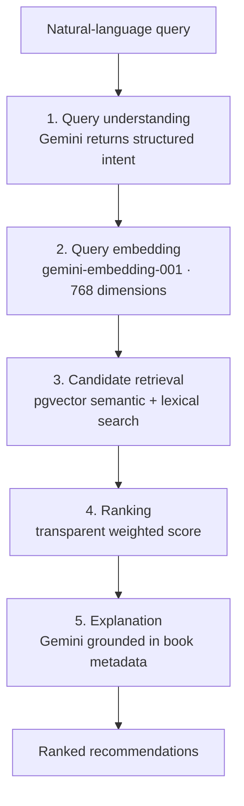
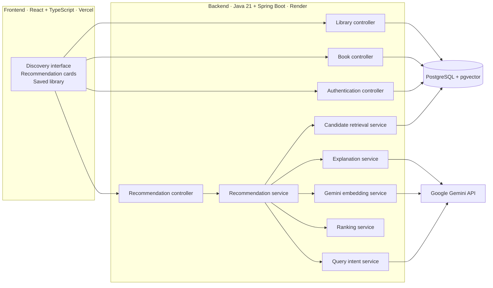

Novi
Find your next read by describing it in plain language.
Novi is a full-stack, AI-powered book discovery platform. Describe the kind of book you're in the mood for, and Novi uses Google Gemini and PostgreSQL `pgvector` to interpret your request, retrieve relevant titles, rank them with a transparent scoring model, and explain why each recommendation fits.
<p align="center">
  <a href="https://novi-blue-five.vercel.app/"><strong>Try the live demo →</strong></a>
  &nbsp; · &nbsp;
  <a href="https://github.com/Manal9667/Novi">View source</a>
  &nbsp; · &nbsp;
  <a href="https://novi-backend-slhh.onrender.com/api/books">Explore the API</a>
</p>
<p align="center">
  
  
  
  
  
  
  
</p>
---
At a glance
	
What it does	Natural-language book discovery with explainable recommendations
Recommendation approach	Query understanding, vector + lexical retrieval, weighted ranking, grounded explanations
Catalog	64 books in the deployed API
Backend	Java 21 · Spring Boot · PostgreSQL · pgvector
Frontend	React · TypeScript
AI	Google Gemini for query understanding, embeddings, and explanations
Deployment	Vercel frontend · Render backend · managed PostgreSQL
Product preview
<!--
Add real screenshots captured from the deployed application.
Save them under docs/screenshots/ and uncomment the relevant lines.

### Discovery


### Recommendations


### Book details and explanation


### Saved library

Screenshots will be added here.
Why Novi?
People often know the kind of reading experience they want, but not the title, author, or exact genre to search for. A query such as “a psychological thriller with an unreliable narrator and a twist ending” expresses more than a keyword or genre filter can capture.
Novi treats that description as a retrieval problem. It interprets the request, searches a curated catalog by semantic similarity as well as literal terms, ranks candidate books using inspectable signals, and generates a short explanation grounded in each book's metadata.
The product is intentionally focused on discovery, explainable recommendations, and a saved-books library.
Features
Natural-language discovery: Search by mood, theme, author, cultural context, similarity, or reading preferences.
Hybrid retrieval: Combine semantic vector search with lexical matching so results can reflect both meaning and specific terms.
Transparent relevance scores: Calculate recommendation scores using an explicit weighted formula rather than an opaque model-generated percentage.
Grounded explanations: Generate explanations from retrieved book metadata and fall back to deterministic descriptions when needed.
Graceful degradation: Continue with lexical retrieval and deterministic explanations when Gemini is unavailable.
Accounts and saved library: Register, log in, and save or remove books with user-scoped access control.
Persistent catalog embeddings: Seed the catalog idempotently and persist generated embeddings rather than regenerating them on every restart.
How the recommendation engine works
A `POST /api/recommendations/ask` request is orchestrated by `RecommendationService` and passes through five stages:

1. Query understanding
`QueryIntentService` sends the user's query to Gemini and parses structured intent fields, including genres, themes, cultural context, authors, similar titles, moods, keywords, and length. If the response is malformed or unavailable, deterministic keyword extraction provides a fallback.
2. Embedding
The intent-expanded query is embedded with Gemini's `gemini-embedding-001` model using 768 dimensions. The resulting vector is used for semantic candidate retrieval.
3. Hybrid candidate retrieval
`CandidateRetrievalService` combines two retrieval paths:
Semantic retrieval: PostgreSQL `pgvector` cosine-distance search over the `embedding_vec` column. The semantic retrieval contribution is weighted at `0.6`.
Lexical retrieval: `ILIKE` searches across book titles, descriptions, authors, genres, and themes. The lexical contribution is weighted at `0.4` and normalized by the number of concrete intent terms.
A raw-query fallback is used if both paths return no candidates. For signed-in readers, books already in their saved library are excluded from recommendations.
4. Transparent ranking
`RankingService` calculates an interpretable score for each candidate:
```text
relevance =
  (wSemantic * cosineSimilarity + wMetadata * metadataMatch)
  / (wSemantic + wMetadata)

final =
  (1 - wPreference) * relevance
  + wPreference * savedBookAffinity

relevanceScore = round(final * 100)
```
The default weights are `0.6 / 0.25 / 0.15` and are configurable under `novi.ai.ranking`.
`cosineSimilarity` measures similarity between the query and book embeddings. It is `0` when embeddings are unavailable.
`metadataMatch` measures the fraction of concrete query terms found in a book's title, authors, genres, or themes.
`savedBookAffinity` measures overlap between a candidate's genres/themes and the reader's saved books. This preference signal is bounded and is used for signed-in readers.
Candidates are deduplicated, sorted by score, and limited to the configured result count.
5. Grounded explanations
`ExplanationService` sends the top candidates' retrieved metadata to Gemini and requests a concise reason each book matches the query. Responses are validated against known book IDs. If Gemini skips a book or is unavailable, Novi generates a deterministic explanation from that book's own genres and themes.
Each recommendation includes its book ID, title, authors, cover image URL, description, genres, themes, relevance score, and explanation.
System architecture

The backend separates HTTP controllers, business services, repositories, and DTOs. JPA entities are not returned directly as API responses.
Database and vector search
Flyway manages the relational schema and vector-search migration in `backend/src/main/resources/db/migration`.
V1 — `V1__init_schema.sql`: Creates users, books, authors, genres, themes, their join tables, and `user_books` for saved books, with relational constraints and indexes.
V2 — `V2__pgvector_embeddings.sql`: Enables the `vector` extension when available, adds `books.embedding_vec vector(768)`, and creates an HNSW index using `vector_cosine_ops`.
Book embeddings are generated from the title, authors, genres, themes, and description. The application stores the embedding as a JSON float array in `books.embedding` and mirrors it into `embedding_vec` for native vector retrieval. `CatalogSeeder` loads the curated dataset from `backend/src/main/resources/data/books.json`, avoids duplicate seed records, and generates embeddings for books that do not already have them.
The semantic retrieval query uses cosine distance:
```sql
SELECT *
FROM books
WHERE embedding_vec IS NOT NULL
ORDER BY embedding_vec <=> CAST(:vec AS vector)
LIMIT :k;
```
If native pgvector retrieval is unavailable, `PgVectorSupport` disables that path and lexical retrieval remains available.
Production deployment evidence: the live catalog endpoint returned 64 books. The deployment logs also reported successful embedding generation for all 64 catalog books and enabled native pgvector retrieval.
Authentication and API
Novi uses stateless JWT authentication. Passwords are hashed with BCrypt, and the JWT uses HMAC-SHA256 with a 24-hour expiry. A request filter validates bearer tokens. The application rejects the development JWT secret outside a local profile and requires a sufficiently long secret.
Catalog browsing and recommendation discovery are public. Saved-library endpoints require authentication. Registration and login endpoints are rate-limited by client IP.
Method	Endpoint	Access	Purpose
`POST`	`/api/auth/register`	Public	Create an account and receive a JWT
`POST`	`/api/auth/login`	Public	Authenticate and receive a JWT
`POST`	`/api/recommendations/ask`	Public	Request natural-language recommendations
`GET`	`/api/books`	Public	Browse the paginated catalog
`GET`	`/api/books/{id}`	Public	Retrieve book details
`GET`	`/api/library`	JWT	List saved books
`POST`	`/api/library/books`	JWT	Save a book
`DELETE`	`/api/library/books/{bookId}`	JWT	Remove a saved book
`POST`	`/api/books/backfill-embeddings`	Admin	Backfill missing book embeddings
A `(user, book)` uniqueness constraint prevents the same book from being saved more than once.
Testing
Suite	Tests	Tooling
Backend unit	24	JUnit 5, Mockito
Backend integration	7	Spring Boot Test, Testcontainers
Frontend	17	Vitest, Testing Library
Backend unit tests cover query parsing, hybrid ranking, ordering and weighting, deduplication, preference scoring, grounded explanation generation and fallback, pipeline orchestration, and saved-book operations. The Gemini client is mocked in these tests, so they do not make live API calls.
Integration tests exercise Flyway migrations and backend endpoints against a disposable PostgreSQL container with pgvector. The backend also includes an offline retrieval-evaluation harness that calculates Precision@K, Recall@K, MRR, and nDCG@K over a reproducible synthetic dataset.
Run the checks locally:
```bash
# Backend unit tests
cd backend
mvn test

# Backend tests, including Testcontainers integration tests (Docker required)
mvn verify

# Frontend tests and production build
cd ../frontend
npm run test:run
npm run build
```
Deployment
Component	Platform	Deployment
Frontend	Vercel	Static Vite application
Backend	Render	Dockerized Spring Boot service
Database	Managed PostgreSQL	PostgreSQL with pgvector
AI services	Google Gemini	Query understanding, embeddings, and explanations
The frontend's `VITE_API_BASE_URL` points to the deployed backend API. The backend's `CORS_ALLOWED_ORIGINS` must include the frontend origin. On startup, the backend applies Flyway migrations, seeds missing catalog records, and generates embeddings for books that do not already have them.
Run locally
Prerequisites
Docker and Docker Compose
Java 21 and Maven (for running the backend manually)
Node.js (for running the frontend manually)
A Gemini API key for AI-powered query understanding, embeddings, and explanations
Option A: Docker Compose
From the repository root:
```bash
export JWT_SECRET="$(openssl rand -base64 48)"
export GEMINI_API_KEY="your-gemini-api-key"
docker compose up --build
```
The app is available at:
Frontend: `http://localhost:5173`
Backend API: `http://localhost:8080`
Backend health: `http://localhost:8080/actuator/health`
PostgreSQL: `localhost:5432`
If you need to reset the local database volume, use `docker compose down -v`. This deletes the local database data.
Option B: Run services separately
Start the database from the repository root:
```bash
docker compose up -d db
```
Start the backend from `backend/`:
```bash
SPRING_PROFILES_ACTIVE=dev GEMINI_API_KEY=your-gemini-api-key mvn spring-boot:run
```
Start the frontend from `frontend/`:
```bash
npm install
npm run dev
```
The Vite development server proxies `/api` requests to `http://localhost:8080`. The `dev` profile permits the committed placeholder JWT secret for local development only.
Configuration
Set secrets through environment variables. Do not commit real credentials or `.env` files.
Backend
Variable	Required	Default / notes
`JWT_SECRET`	Yes in production	Use a strong secret of at least 32 bytes
`GEMINI_API_KEY`	No	Enables Gemini-powered features; fallback paths remain available
`GEMINI_MODEL`	No	`gemini-flash-lite-latest`
`GEMINI_EMBEDDING_MODEL`	No	`gemini-embedding-001`
`NOVI_EMBEDDING_DIMENSIONS`	No	`768`; must match the database vector dimension
`CORS_ALLOWED_ORIGINS`	No	Defaults to local development origins
`DB_HOST`, `DB_PORT`, `DB_NAME`	No	Defaults to local PostgreSQL settings
`DB_USER`, `DB_PASSWORD`	No	Database credentials
Frontend
Variable	Required	Purpose
`VITE_API_BASE_URL`	In production when API is hosted separately	Backend API base URL; local development uses the Vite proxy
Repository structure
```text
Novi/
├── backend/
│   ├── src/main/java/com/novi/
│   │   ├── controller/
│   │   ├── service/
│   │   ├── repository/
│   │   ├── entity/
│   │   ├── dto/
│   │   ├── security/
│   │   ├── config/
│   │   ├── exception/
│   │   └── eval/
│   ├── src/main/resources/
│   │   ├── db/migration/
│   │   └── data/books.json
│   └── Dockerfile
├── frontend/
│   ├── src/
│   ├── Dockerfile
│   └── nginx.conf
├── docker-compose.yml
└── README.md
```
Potential next steps
Expand the curated catalog through a vetted data-import workflow.
Cache query embeddings to reduce repeated embedding calls and latency.
Add pagination or progressive loading to recommendation results.
Persist recommendation history to support longer-term personalization.
---
Built to explore practical full-stack engineering, retrieval-augmented generation, explainable ranking, vector search, and production deployment.